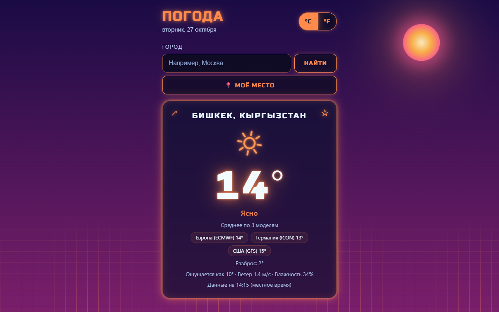
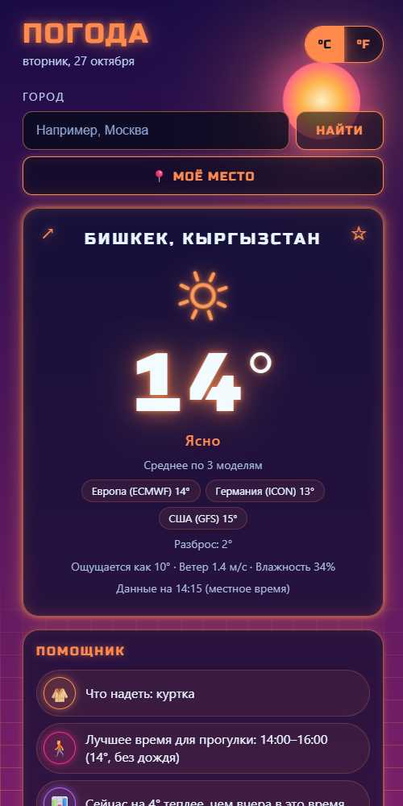
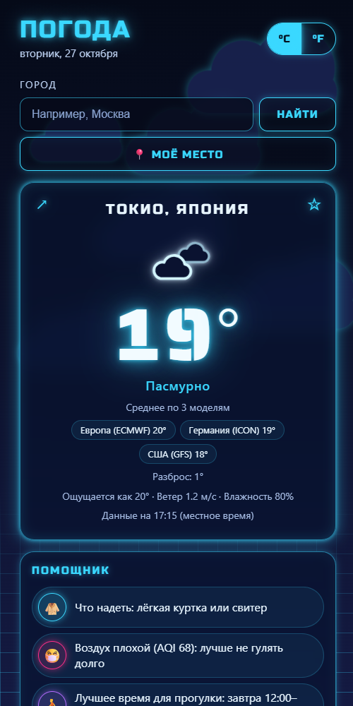

# Neon Weather 🌦

A neon-styled weather app that runs in the browser: plain HTML, CSS and JavaScript, no install, no API keys.

## ▶ Open the app: https://sivatorx.github.io/neon-weather/

  
  

## Features
- **Three weather models in one:** the big number is the average of the European (ECMWF), German (ICON) and US (GFS) models. You also see each model's value and how much they disagree.
- **Pick the right city:** "Paris" finds Paris in France *and* four towns in the USA, so you choose instead of the app guessing.
- **Next 24 hours, 7-day forecast and a temperature chart** drawn in SVG.
- **Assistant:** what to wear for the rest of the day, the best 2 hours for a walk, a comparison with yesterday, and a **read aloud** button (Web Speech API).
- **Weather warnings:** frost, heat, thunderstorms, strong wind, heavy rain or snow in the next 7 days.
- **Live background:** sun, stars, drifting clouds, rain, snow and soft lightning that match the real weather and the time of day.
- **Neon animated icons** made in SVG, the same on every phone.
- **Sun and air:** sunrise, sunset, day length and air quality (European AQI, PM2.5, PM10).
- **Rain radar** on a dark map, with the last 2 hours as an animation.
- **My location, favourite cities** and the last city remembered on your device.
- **°C / °F switch** and a **share** button that sends a link opening the same city.
- Works on phones, respects "reduce motion", and is usable with a keyboard and screen readers.

## How it works
- Weather, city search and air quality: [Open-Meteo](https://open-meteo.com/) (free, no key).
- City name for "My location": [BigDataCloud](https://www.bigdatacloud.com/) reverse geocoding (free, no key).
- Rain radar: [RainViewer](https://www.rainviewer.com/) data on an Esri dark map, with [Leaflet](https://leafletjs.com/).
- No frameworks and no build step: open `index.html` and it runs.

This is my second project. The first one is the neon Battleship game [Neon Armada](https://github.com/sivatorX/neon-armada).

© 2026 Armin ([sivatorX](https://github.com/sivatorX))
